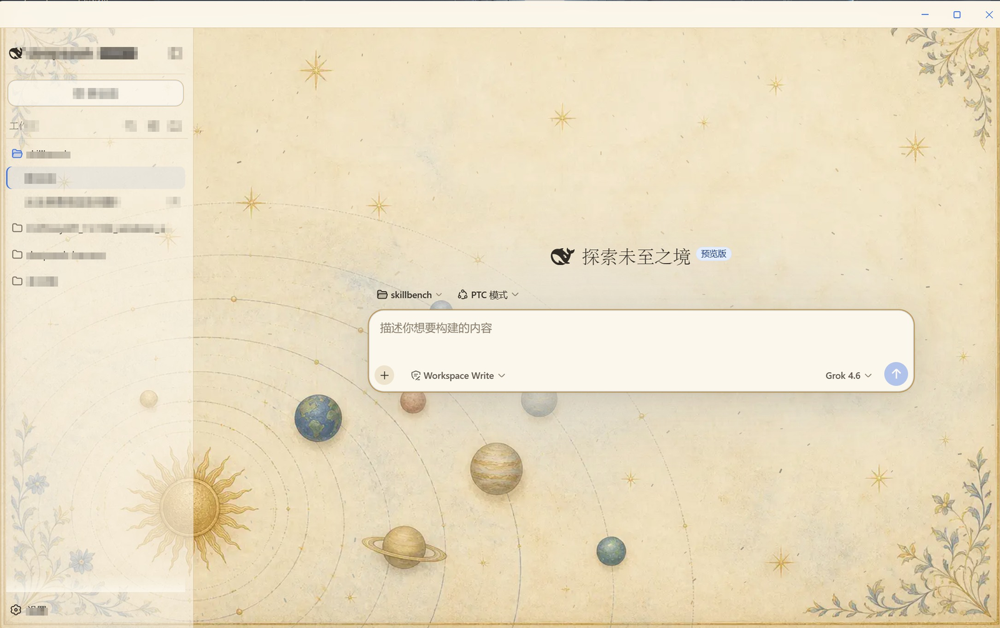
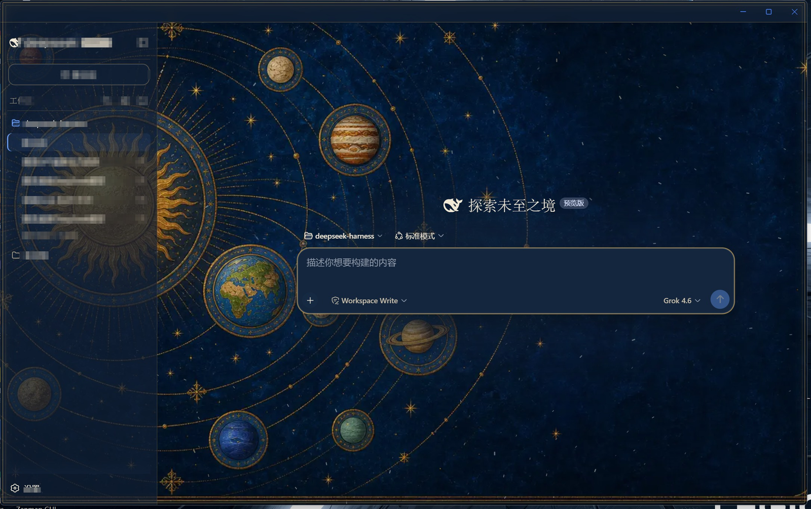

# dsh-client-ui-celestial

DeepSeek Harness 的 web profile 插件：在官方界面上叠加羊皮纸 / 星空配色、背景插画和粒子。

不改官方仓库。装上之后走 Loader，和官方插件同一套机制。

## 预览

浅色：



深色：



## 安装

```sh
dsh plugin --profile web add github:DoTrungHuy/dsh-client-ui-celestial
```

这条命令会把包装进 web profile，并自动写入 Loader 行。然后重新启动：

```sh
dsh web
```

在应用里：

- 设置 → 插件 → 全部插件：搜 `ui-celestial`
- 设置 → 插件 → 插件配置：卡片 **天体工作台 / Celestial workbench**

卸载：

```sh
dsh plugin --profile web remove dsh-client-ui-celestial
```

然后重启 `dsh web`。

## 开发

```sh
pnpm install
pnpm run build
```

`lib/` 是 Host 入口和浏览器包，安装时会用到。改源码后重新 build 再重启 Host。
